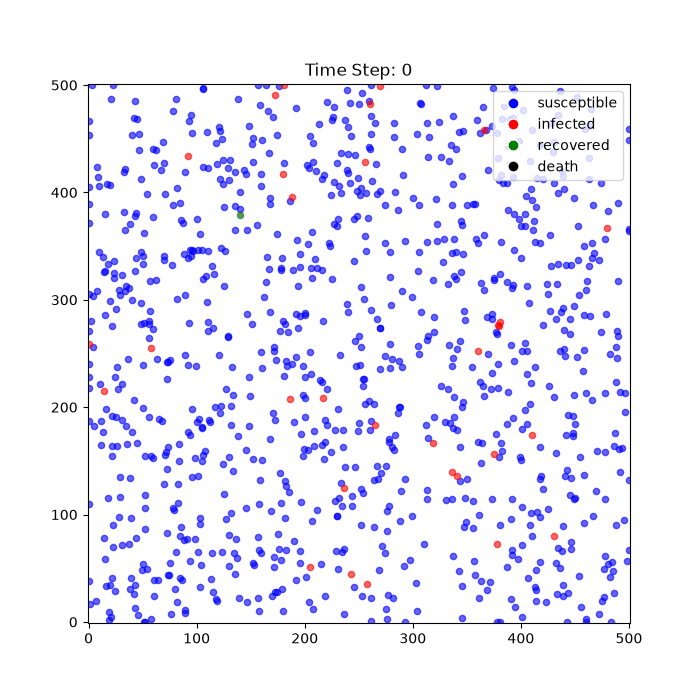
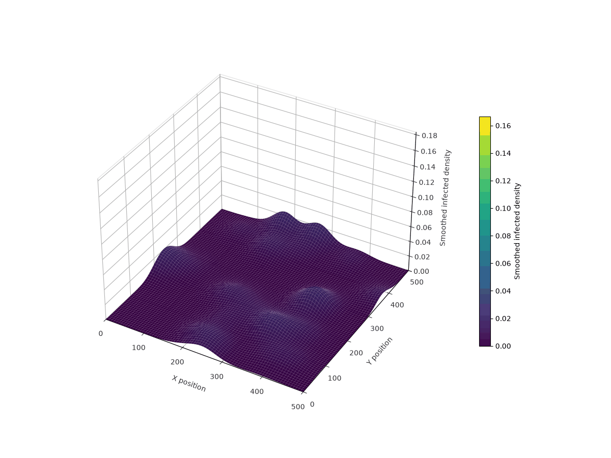

# Epidemic Simulation Benchmark

Research code for comparing an Esper Entity Component System epidemic model
with a Mesa agent-based implementation.

This is an independent exploration of whether a data-oriented ECS architecture
can express a nontrivial spatial epidemic model and provide a useful basis for
a controlled comparison with a conventional object-oriented agent-based model.

## Current Status

The ECS and Mesa models are implemented, with shared simulation and disease
configuration objects used by both implementations. The benchmark experiments
compare their epidemic outcomes and profile their runtime.

The project currently demonstrates:

- Mobile agents in a bounded two-dimensional space
- Spatial transmission based on distance and susceptibility
- Weighted contact-network transmission
- Random and spatial-age homophily networks
- Dynamic network rewiring
- Infection-hazard accumulation and resolution
- Disease progression, recovery, and death
- Optional quarantine with mobility and transmission effects
- Reproducible, model-owned random streams
- Temporal and spatial result collection

## Layout

- `src/epidemic_sim/ecs`: implemented Esper model, components, and systems
- `src/epidemic_sim/mesa`: Mesa implementation
- `src/epidemic_sim/networks`: shared network utilities
- `src/epidemic_sim/data`: data-related package code
- `src/epidemic_sim/analysis`: library analysis and visualization utilities
- `scripts`: executable ECS and Mesa runners, plus data-generation scripts
- `experiments`: benchmark, profiling, and parity experiment code
- `data`: raw, processed, and generated datasets
- `results` and `project_outputs`: generated artifacts

## Installation

The project uses uv for environment and dependency management:

```bash
uv sync
uv run python -c "from epidemic_sim.ecs.simulation import SIREpidemicModel; print('Package import: OK')"
```

## Running the ECS Model

Run the implemented ECS simulation with:

```bash
uv run python scripts/run_ecs.py
```

The runner uses a 1,000-agent illustrative configuration and saves generated
figures in the current working directory. To keep outputs together, run it
from `project_outputs`:

```bash
cd project_outputs
uv run python ../scripts/run_ecs.py
```

The ECS workflow produces epidemic curves, a spatial-agent animation, a spatial
heatmap, and an infected-density 3D wave using the `viridis` colormap.

Example visual outputs:





The synthetic-data script expects its source CSV files under `data/raw`:

```bash
uv run python scripts/generate_data.py
```

The synthetic-data workflow additionally requires SDV, which is kept outside
the core dependencies because its current releases do not resolve for Python
3.12.

## ECS vs Mesa Benchmark

Follow the step-by-step protocol in [experiments/README.md](experiments/README.md).
In short, check structural parity, run independent epidemiological replicates,
then measure runtime at fixed population sizes and steps:

```bash
uv run pytest tests/test_structural_parity.py
uv run python -m experiments.profiling.benchmark_models --n-agents 1000 --steps 50 --repeats 30 --warmups 3
uv run python -m experiments.plot_benchmark_results --runtime results/runtime_*.json
```

The runtime command saves repeat-level JSON; the plot command produces
`results/runtime_comparison.png`. The current runtime protocol disables spatial
history in both implementations and runs an equal fixed number of steps. The Mesa model is also available through
`scripts/run_mesa.py`.

Both model constructors accept the shared configs. The older keyword-based
constructors remain supported; when a config is supplied, it takes precedence
over legacy arguments for that config's values:

```python
from epidemic_sim.config import SimulationConfig
from epidemic_sim.disease_model import DiseaseModelConfig
from epidemic_sim.mesa import MesaSIREpidemicModel

model = MesaSIREpidemicModel(
    simulation_config=SimulationConfig(seed=42, n_agents=300),
    disease_model_config=DiseaseModelConfig(
        beta_spatial=0.3,
        spatial_new=True,
        network_new=True,
    ),
)
```

Mesa stores its directed contact network as a weighted NetworkX graph; the
graph is the source of truth for contact transmission and rewiring.
Both implementations use a single seeded NumPy generator for simulation
randomness. This gives repeatable runs per implementation and seed; it does
not pair or synchronize random draws between ECS and Mesa.

## Contributing

Contributions are welcome, especially in these areas:

- Implementing the Mesa parity model
- Validating ECS and Mesa state-transition equivalence
- Designing reproducible benchmark experiments
- Profiling runtime and memory scaling
- Adding tests for seeded reproducibility and world isolation
- Implementing extensions such as vaccination or new health compartments
- Improving documentation and scientific reproducibility

Please keep comparisons fair: ECS and Mesa implementations should use the same
parameters, mechanisms, output definitions, and comparable algorithms.

## License

This project is released under the Apache License 2.0. See [LICENSE](LICENSE)
for the complete terms.